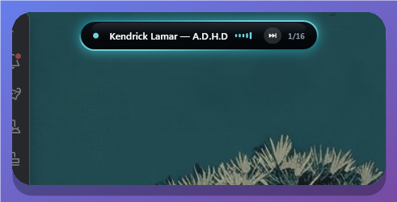
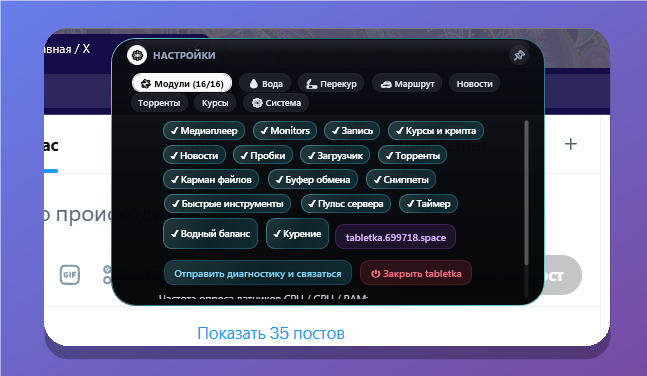
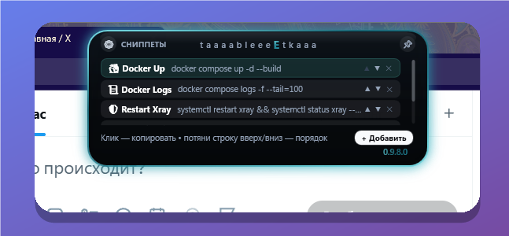
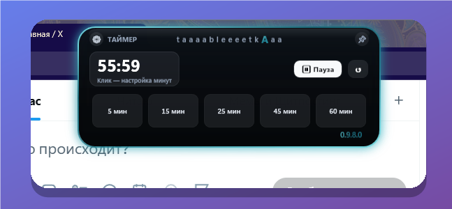

# tabletka

Lightweight native desktop overlay pill and widget center for **Windows (.NET 8 / WPF)** with optional **Android** companion sync via `relay.699718.space`.

- **Official Landing & Download:** [tabletka.699718.space](https://tabletka.699718.space/?utm_source=github&utm_medium=readme&utm_campaign=tabletka_repo)
- **Latest Windows x64 Installer:** [tabletka_0.9.8.44_x64_Setup.exe](https://699718.space/tabletka/tabletka_0.9.8.44_x64_Setup.exe)
- **Contact & Support:** [@eggrib](https://t.me/eggrib)

## Preview

| Compact Capsule on Desktop | Hardware Monitors (CPU / GPU / RAM / Net) |
| --- | --- |
|  |  |

| 16 Modules Control Panel | Edge Docking, Game Hide & 10 Languages |
| --- | --- |
|  |  |

| Quick Developer Snippets | Mouse-Wheel Timer |
| --- | --- |
|  |  |

## Key Features

- **Compact Pill Form-Factor:** Edge-dragging top screen capsule with instant expansion into full widgets.
- **16 Built-in Modules:** Media player with live lyrics, clipboard link downloader, screen backdrop & recorder, screenshot auto-copy, File Pocket, system & market monitors, server pulse, notes/snippets, Pomodoro timer, habits, and quick tools.
- **Performance & Throttling:** Two-thread download queue, fullscreen game auto-hide, and smart background module throttling.
- **10 Languages:** Full UI localization (`en`, `ru`, `de`, `fr`, `es`, `he`, `ja`, `ko`, `zh`, `tr`).

## Distribution Policy

Official builds are distributed exclusively as compiled Windows x64 installers via [tabletka.699718.space](https://tabletka.699718.space/?utm_source=github&utm_medium=readme&utm_campaign=tabletka_repo) and GitHub Releases. Source code is private to ensure binary integrity and prevent unauthorized clones.

### What's New in v0.9.8.44
- **Gaming Mode Glow:** automatic island contour & audio-visualizer palette switch when a game is active (4 presets: Crimson, Emerald, Violet, Amber) + automatic game process priority boost.
- **Resilient Media & Network Pipeline:** unified download queue with automatic fallback and local proxy detection for smoother clipboard link handling.
- **Performance & Obfuscation Hardening:** unified SharedHttpService connection pooling, zero-reflection runtime paths, and full JSON model preservation under Obfuscar.
