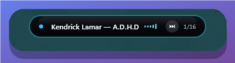
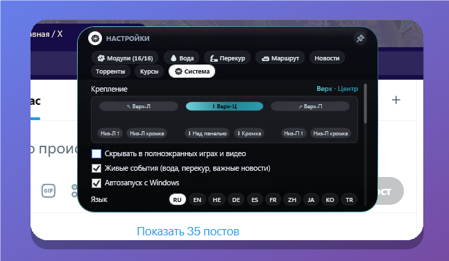
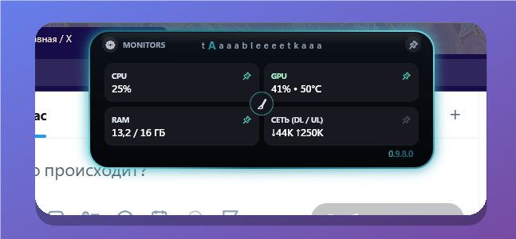

# tabletka

Lightweight native desktop overlay pill and widget center for **Windows (.NET 8 / WPF)** with optional **tabletkaCompanion (Android)** sync via `relay.699718.space`.

- **Official Landing & Download:** [tabletka.699718.space](https://tabletka.699718.space/?utm_source=github&utm_medium=readme&utm_campaign=tabletka_repo)
- **Android Companion App:** [tabletkaCompanion / Android](https://699718.space/companion.html?utm_source=github&utm_medium=readme&utm_campaign=companion)
- **Latest Windows x64 Installer:** [tabletka_0.9.8.70_x64_Setup.exe](https://699718.space/tabletka/tabletka_0.9.8.70_x64_Setup.exe) (`SHA-256: 6d66a531…9290a123` · [VirusTotal 0/68](https://www.virustotal.com/gui/file/6d66a531a83336b3643b866d108a2e048daccae8d90d36b3f795e22e9290a123))
- **Contact & Support:** [@eggrib](https://t.me/eggrib)

## Preview

| Compact Capsule on Desktop | Expanded Media Widget |
| --- | --- |
|  |  |

| 16 Modules Control Panel | Edge Docking, Game Hide & 10 Languages |
| --- | --- |
|  |  |

## Key Features

- **Compact Pill Form-Factor:** Edge-dragging top screen capsule with instant expansion into full widgets.
- **16 Built-in Modules:** Media player with live lyrics, clipboard link downloader, screen backdrop & recorder, screenshot auto-copy, File Pocket, system & market monitors, server pulse, notes/snippets, Pomodoro timer, habits, and quick tools.
- **Performance & Throttling:** Two-thread download queue, fullscreen game auto-hide, and smart background module throttling.
- **10 Languages:** Full UI localization (`en`, `ru`, `de`, `fr`, `es`, `he`, `ja`, `ko`, `zh`, `tr`).

## Distribution Policy

Official builds are distributed exclusively as compiled Windows x64 installers via [tabletka.699718.space](https://tabletka.699718.space/?utm_source=github&utm_medium=readme&utm_campaign=tabletka_repo) and GitHub Releases. Source code is private to ensure binary integrity and prevent unauthorized clones.

### What's New in v0.9.8.70
- **News 2.0, Traffic 2.0 & Habit Tracker 2.0:** Interactive category filter tabs (`All`, local city, country, `World`, `IT`), 16-item scrollable feed, relative timestamps, and read-state dimming in News; coordinate-matched congestion scores across 55 cities with traffic-adjusted ETA, arrival clock, `From ↔ To` route swap, and live Photon OSM address autocomplete in Traffic; natural `05:00` biological day rollover, 1-click Undo, sleep toggle, and 7-day mini bar chart in Habit Tracker.
- **Live Lyrics 2.0 & Voice Studio:** Smooth karaoke auto-scroll with click-to-seek on any lyric line, adaptive font sizing, and local lyrics caching alongside 3 WASAPI 48 kHz voice/call capture modes (`Mic`, `Mic+PC`, `PC Audio`).
- **ECDSA P-256 Supply-Chain Security & Multi-Mirror OTA:** Offline `ECDSA P-256` manifest signature verification (`SHA-256` + deterministic `.NET 8` build paths) and automatic multi-mirror update failover with 5-second per-mirror timeouts.
- **Zero Idle/Gaming CPU & 10 Languages:** Native `.NET 8 / WPF` 60 FPS overlay with `DATAS` adaptive GC, automatic WASAPI/timer sleep in fullscreen games and tray, and full localization across 10 languages.
