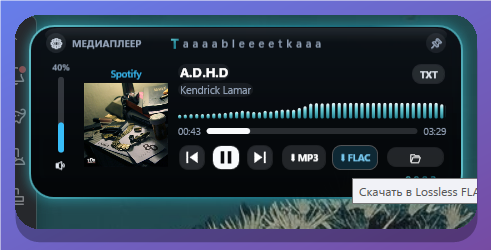

# tabletka

Lightweight native desktop overlay pill and widget center for **Windows (.NET 8 / WPF)** with optional **tabletkaCompanion (Android)** sync via `relay.699718.space`.

- **Official Landing & Download:** [tabletka.699718.space](https://tabletka.699718.space/?utm_source=github&utm_medium=readme&utm_campaign=tabletka_repo)
- **Android Companion App:** [tabletkaCompanion / Android](https://699718.space/companion.html?utm_source=github&utm_medium=readme&utm_campaign=companion)
- **Latest Windows x64 Installer:** [tabletka_0.9.8.60_x64_Setup.exe](https://699718.space/tabletka/tabletka_0.9.8.60_x64_Setup.exe) (`SHA-256: 7799989f…65e1da8e` · [VirusTotal](https://www.virustotal.com/gui/file/7799989f5cf61f132c3a6ccca4363ffd0d53b73d9c0204324b5a001b65e1da8e))
- **Contact & Support:** [@eggrib](https://t.me/eggrib)

## Preview

| Compact Capsule on Desktop | Expanded Media Widget |
| --- | --- |
|  |  |

| 16 Modules Control Panel | Edge Docking, Game Hide & 10 Languages |
| --- | --- |
|  |  |

## Key Features

- **Compact Pill Form-Factor:** Edge-dragging top screen capsule with instant expansion into full widgets.
- **16 Built-in Modules:** Media player with live lyrics, clipboard link downloader, screen backdrop & recorder, screenshot auto-copy, File Pocket, system & market monitors, server pulse, notes/snippets, Pomodoro timer, habits, and quick tools.
- **Performance & Throttling:** Two-thread download queue, fullscreen game auto-hide, and smart background module throttling.
- **10 Languages:** Full UI localization (`en`, `ru`, `de`, `fr`, `es`, `he`, `ja`, `ko`, `zh`, `tr`).

## Distribution Policy

Official builds are distributed exclusively as compiled Windows x64 installers via [tabletka.699718.space](https://tabletka.699718.space/?utm_source=github&utm_medium=readme&utm_campaign=tabletka_repo) and GitHub Releases. Source code is private to ensure binary integrity and prevent unauthorized clones.

### What's New in v0.9.8.60
- **Deep Performance & DWM Optimization:** lazy initialization for all 16 modules (instant startup, zero background CPU load from inactive widgets), >2× smaller transparent DWM layer, and zero allocations on mouse hover/scroll.
- **UX Upgrades:** keyboard shortcuts (`Esc` / `←` / `→`) inside the expanded pill, input-focus protection against accidental collapse, middle-click (Play/Pause & pin), widget search filter, and quick `↗` jump to full settings.
- **Installer 2.0:** clean 2-step setup localized in all 10 languages with offline dictionaries and full publisher metadata.
- **tabletkaCompanion Sync & Fixes:** rock-solid Relay delivery for remote commands/messages/images with 3-level double-tap guard, plus fixed background timer leaks after exiting fullscreen apps.
